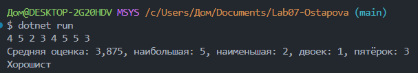
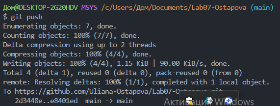

# Практическая работа №7 

**ФИО:** Остапова Ульяна Алекандровна 
**Группа:** ИСП-241
**Дата:** 04.11.2026

## Что изучено 
- Создание массивов для хранения значений одного типа и получение доступа к их элементам по индексу, который начинается с нуля.

- Перебор элементов массива с помощью циклов `for` и `foreach`. Цикл `for` используется, когда мы собираемся изменять элементы массива, а если нам нужны только их значения, то используем `foreach`.

- Выполнение основных операций с массивами: находить сумму, среднее, максимальное и минимальное значения, подсчёт по условию.

